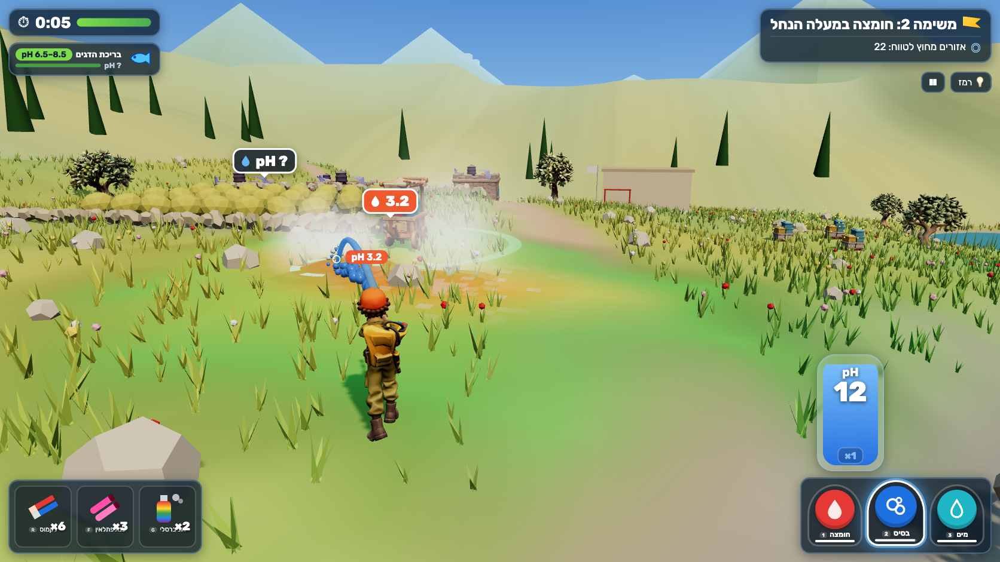

# pH Rangers — סיירת ה-pH

A 3D browser game for Hebrew-speaking grade-8 science students (Israeli curriculum, per [Workbook](https://science.workbook.co.il/grade-8), chapter 10). de Blob meets firefighting, with chemistry in the tank: you're a ranger with a backpack sprayer (acid / base / water valves) and indicator gadgets, and you race spreading acid and alkaline spills across a Galilee valley. Guessing wastes tank, overshooting turns the meadow purple, and water only floods the problem downhill.



## Run

```bash
npm install
npm run dev        # http://127.0.0.1:5197 (strictPort)
npm test           # pH model, ledger, every mission solved by a bot, wrong strategies fail (~30 s)
npm run build      # static build in dist/ (relative base, works offline)
npm run preview    # http://127.0.0.1:4197
```

Add `?all` to the URL to unlock every mission, `?autopause=0` to stop auto-pausing when the tab is hidden (used by the capture script).

## Controls

| | Desktop | Touch |
|---|---|---|
| Move | WASD, Shift to sprint | left stick |
| Aim | mouse (right-click or double-click locks the mouse for camera look); ←/→ turn, PgUp/PgDn tilt | drag on the right half |
| Spray | hold left click or Space; a quick tap = one small puff | spray button |
| Valve | 1 acid · 2 base · 3 water (or Q/E, mouse wheel, HUD buttons) | HUD buttons |
| Strength | X toggles ×1 / ×10 concentrate (when available) | tap the strength chip |
| Gadgets | R litmus · F phenolphthalein · G universal-indicator mist · T antacid canister | HUD buttons |
| Other | H hint · Esc pause · M mute · Enter continue/retry | pause button |

Refill by standing in the green ring at a supply wagon.

## What's implemented

- Six missions (see [CURRICULUM.md](CURRICULUM.md)): Lemon Spill (tutorial), Upstream Acid (×10 rule), Quarry Dust (phenolphthalein), Rina's Blueberries (different targets), Storm Front (acid rain + weak-base canisters), Night Spill (no-hint transfer in a different valley).
- Authoritative pure-TypeScript pH model ([src/sim](src/sim)): grid of zones with volume, signed H⁺/OH⁻ excess, salt, heat, weak base; creek flow, runoff, diffusion; conserved ledger; indicators per Workbook.
- Three.js scene: terrain with a live indicator wash driven by the grid, creek and pond, Tripo models (rigged ranger with idle/run plus a procedural spray pose, tanker, hives, wagon, olive trees, houses), particles, steam, blooming flowers, fish and bees that react to their zone's pH, day and night lighting.
- Hebrew RTL HUD laid out after the ChatGPT gameplay mockups; synthesized WebAudio; reduced-motion and mute; pause on tab hide; lost-WebGL message; touch controls.
- Test hooks: `window.render_game_to_text()` and deterministic `window.advanceTime(ms)`.
- Learning events logged to `localStorage` only. No backend, accounts, analytics or runtime AI.

Planned / not done: celebrate and slip animations (no Tripo clips; budget), a waving farmer NPC (Rina is a simple procedural figure), music. See [progress.md](progress.md) and [PLAYTEST.md](PLAYTEST.md) for what was verified.

## Deploy to Vercel

Static site, no server code. In Vercel: import `AceDZN/ph-rangers`, framework preset **Vite**, build command `npm run build`, output directory `dist`. Or from a shell: `npx vercel --prod` in the repo root (choose the same settings). Not deployed yet.

## Docs

[GAME_IDENTITY.md](GAME_IDENTITY.md) · [CURRICULUM.md](CURRICULUM.md) · [ASSETS.md](ASSETS.md) · [docs/visual-targets/](docs/visual-targets/) · [docs/VISUAL_REVIEW.md](docs/VISUAL_REVIEW.md) · [PLAYTEST.md](PLAYTEST.md) · [progress.md](progress.md) · [docs/SCIENCE_REVIEW.md](docs/SCIENCE_REVIEW.md) · handoff: [docs/handoff/](docs/handoff/)
