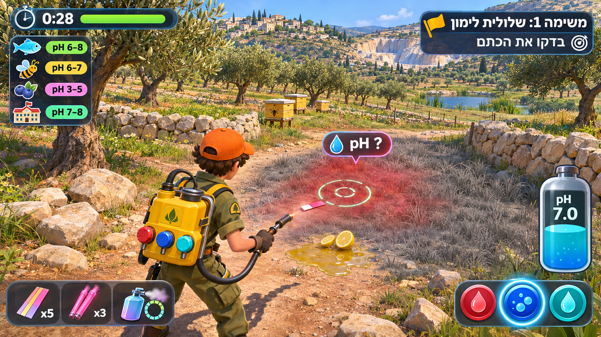
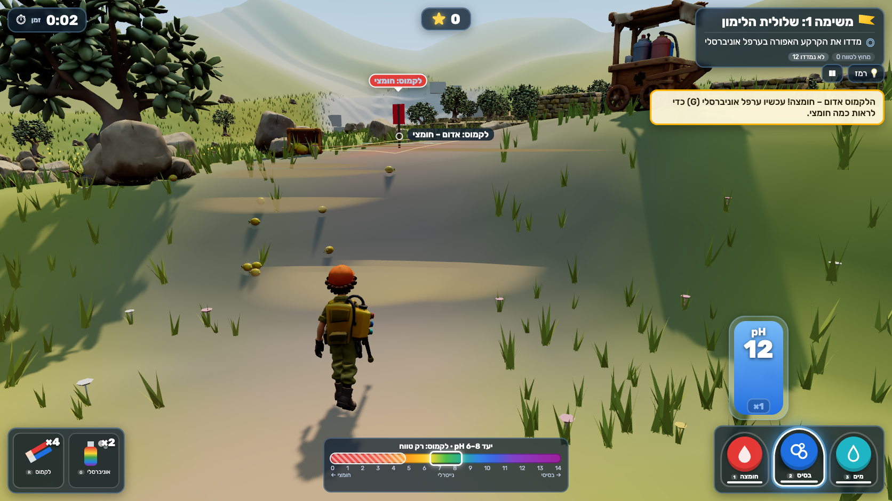
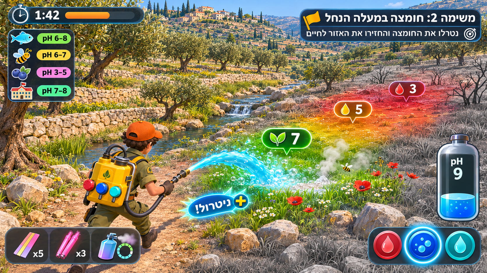
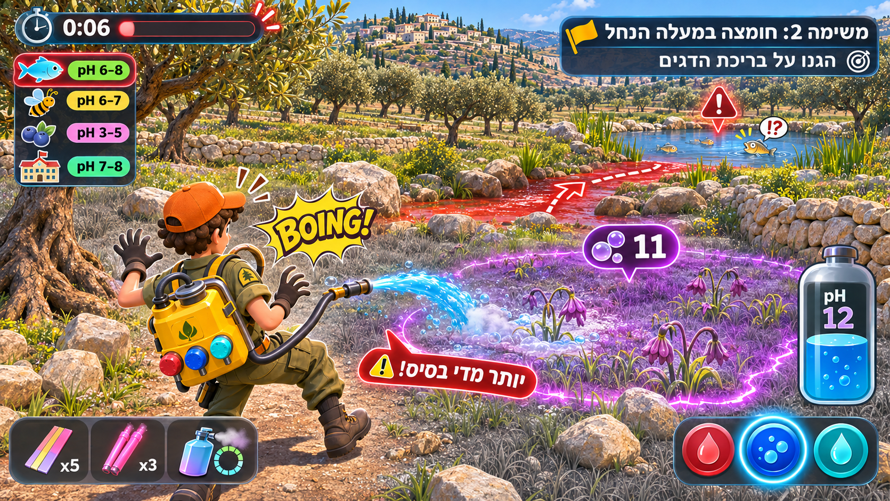
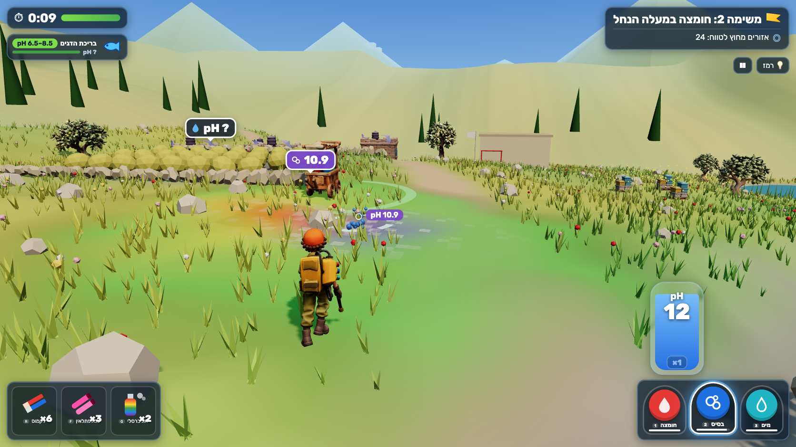
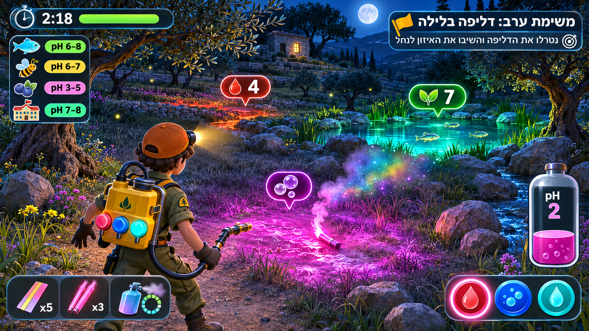
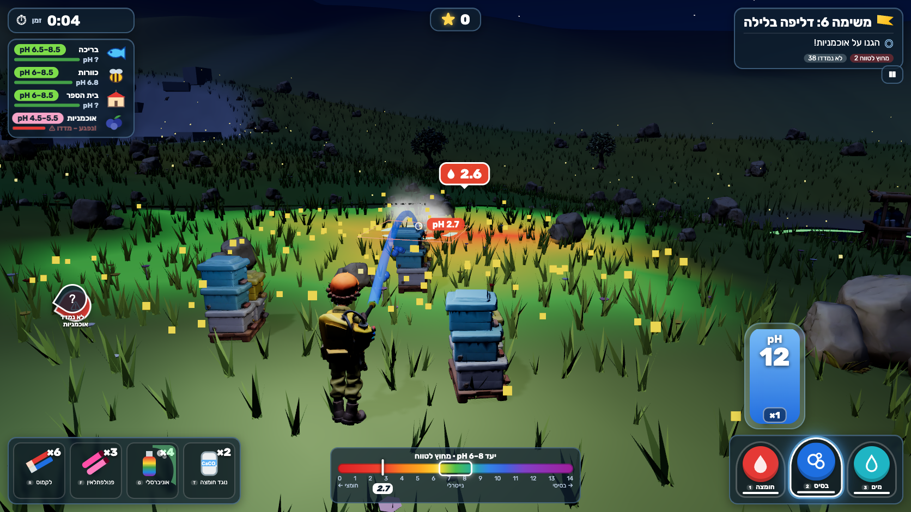

# Visual review — mockups vs real gameplay

Targets: ChatGPT (gpt-image) mockups in [`visual-targets/`](visual-targets/) (prompts in [`PROMPTS.md`](visual-targets/PROMPTS.md)). Actual: real captures in [`captures/`](captures/), taken by [`scripts/capture.mjs`](../scripts/capture.mjs) at the mockups' 1672×941 viewport through real keyboard/mouse input (Playwright Chromium, headed, `?autopause=0`, deterministic `advanceTime`). Mockups are design targets, not evidence; their Hebrew text and pH numbers are often wrong, so only layout and feel were copied.

| Target | Actual |
|---|---|
|  |  |
|  |  |
|  |  |
|  |  |

Extra captures: [title](captures/00-title.png), [phenolphthalein in mission 3](captures/05-phenol.png), [phone width 390×844](captures/06-mobile.png).

## Matches

- **Camera:** over-the-shoulder chase camera, ranger in the lower-left third, valley and target patch ahead, reticle ring on the ground at the spray landing point (all four).
- **Ranger silhouette:** the Tripo ranger was made image-to-3D from the mockup character (olive uniform, orange cap, yellow tank with red/blue/cyan knobs) and is rigged (idle/run) — it reads the same from behind.
- **HUD hierarchy (RTL):** timer + bar top-left with the assets list under it (icon, band chip, live pH or "pH ?", health bar); mission title + objective top-right with flag and target icon; capsule tank with the selected liquid's pH bottom-right above three round valve buttons (red drop, blue bubbles, cyan drop) with the selected one glowing; gadget belt bottom-left (litmus pair, phenolphthalein tubes, universal mist, + antacid when given). Rubik font throughout, numbers in LTR.
- **Feedback:** world badges with icon + number in the universal-indicator colour (drop = acid, bubbles = base, leaf = neutral); the ground wash goes red/orange → green → blue/purple as the number changes; steam where neutralization happens; a solid arcing jet plus droplets; purple badge and "יותר מדי בסיס!" toast with a boing on overshoot.
- **Night:** dark blue valley, moon, the indicator wash and badges glow, fireflies, a head-lamp pool around the ranger.

## Differences (honest)

1. **Art fidelity:** the mockups are painterly renders; the game is a stylized low-poly scene (instanced grass blades, procedural walls and rocks, Tripo props). Lighting and colour palette are matched, detail density is not.
2. **The patch outline** in mockup 3 (a glowing purple border around the overshoot zone) is not drawn; the wash fades softly at cell edges instead.
3. **Grey dead grass:** unknown/stressed ground is desaturated by the shader, but the wilted-grass look of mockups 1–3 is subtler in the game, especially on the dirt path in mission 1 (the lemon puddle decal now carries the cue).
4. **Assets list in mission 1:** the mockup shows four assets; mission 1 has none to protect, so the panel is hidden. Other missions show 1–4 assets with real bands (the mockup bands were invented).
5. **Tank colour:** the game colours the tank by the selected liquid (red acid / blue base / cyan water) and shows its pH number; mockup 4's pink "pH 2" tank was a science error (pink is phenolphthalein's base colour) and was not copied.
6. **Spray pose:** no Tripo spray clip exists; the arms are aimed procedurally, so the pose is stiffer than the mockup's crouch.
7. **Badge density:** to keep the screen readable the game shows at most 8 world badges (and 3 "pH ?" markers), nearest first; mockups show 3–4.

## Fixed after comparing

- Camera moved lower and further back with a right-shoulder offset; aim ray below screen centre (was a top-down view with the ranger cut off).
- Overlay texture treated as sRGB and wash opacity raised (washes looked pale).
- Solid jet added to the droplet stream (the stream looked like a dotted line).
- Cone grass replaced by blade tufts; gem-like flowers replaced by stemmed blooms; terrace walls lowered (they blocked the camera in mission 3); olive model brightened.
- Night head-lamp dimmed and cooled, indicator glow raised, fireflies added.
- Gadget counts moved so they no longer overlap labels; badges de-duplicated on screen.

## Round 2 (after "make it perfect")

Captures in `captures/` were re-taken at 1672×941 after the round-2 changes (same script, real input). Changes against the mockups since round 1:

- **Closer to the mockups:** real dry-stone walls, limestone rocks, a red-tile stone school, blueberry bushes with berries, cypresses and a rigged farmer (all Tripo) replace the primitive props; the spray is a solid jet with a splash; restored ground blooms with red anemones like the poppies in mockup 2; the night mission glows only where something is wrong, like mockup 4.
- **Beyond the mockups:** a score/combo chip at the top centre, the pH ruler at the bottom centre (indicator ranges, target band, next-puff tick), off-screen guidance arrows, a goal-first objective with count chips, a visible storm front, and a title screen over the live valley.
- **Still different:** the mockups' painterly detail density, the purple glowing outline around an overshoot patch (we show a ring burst and the purple wash instead), and the creek's waterfall in mockup 2.
